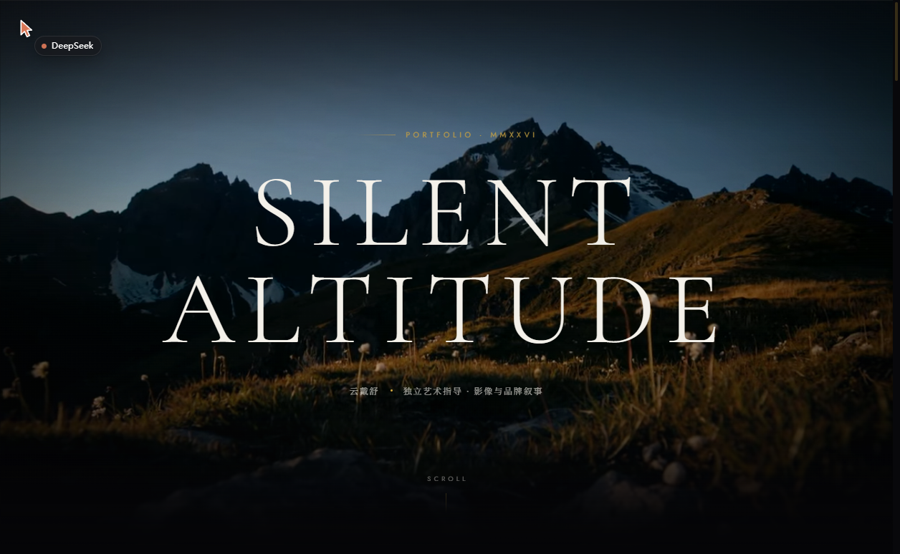

# 静默海拔 · Silent Altitude

一份**黑金静奢风**的个人作品集 / 博客单页：首屏 AI 影像随滚动推近、收圆角、溶入黑场，其下是金框引言、编号作品集、鲲鹏线描会标、**可拖拽摆动的 3D 工牌**，最后以手写体落款收束。

> **在线预览**：https://yundaishu.github.io/silent-altitude/
> 建议桌面浏览器打开，滚一遍再看 3D 工牌（可以直接拖着甩）。

> 黑金静奢风个人作品集。首屏 AI 生成影像随滚动推近、收圆角、溶入黑场；下接金框引言、编号作品、鲲鹏会标、可拖拽的 3D 工牌与手写落款。理念取「大成若缺」，以留白与克制的金让内容呼吸。



---

## 页面结构（自上而下）

| 区块 | 内容 |
|---|---|
| **Hero** | 全屏 AI 影像铺底，滚动时画面推进并收成圆角、下沿溶入黑场；叠白色衬线大字 `SILENT ALTITUDE` 与中文职位行 |
| **引言** | 四角金线框的引用框，中英对照《道德经》「大成若缺，其用不弊」 |
| **Selected Works** | 编号式作品列表（编号 / 标题 / 分类 / 年份），悬停时细金线展开、标题微移 |
| **会标** | 鲲鹏线描圆形徽记，SVG 手绘路径 + 环绕英文沿 `textPath` 缓慢绕行 |
| **个人介绍 · 3D 工牌** | 左列简介与文章条目，右列可拖拽的 3D 工牌，松手有真实回摆，甩幅度够大会翻到背面 |
| **落款** | 手写体签名 + 金色细线 + 「二〇二六年秋 题于深圳」 |


## 技术实现

| 主题 | 做法 |
|---|---|
| **滚动驱动动效** | 把滚动进度写成 CSS 变量（`--hero-progress` / `--doc-progress`），只驱动 `transform` 与 `opacity`；`requestAnimationFrame` 节流，一帧最多算一次，全程零 React 重渲染 |
| **影像与页面融合** | 视频边缘用 `mask-image` 渐隐入黑场，叠加暗角与 5.5% 胶片颗粒，没有硬边 |
| **3D 工牌** | React Bits **官方** Lanyard 组件源码（纯 three.js + CanvasTexture 贴图），保留官方拖拽、绳摆与回弹；卡片正反面纹理由本项目自制 |
| **按需加载** | 3D 区块用 `React.lazy` 拆成独立 chunk，首屏只解析主包，three.js 延后加载 |
| **无障碍** | 完整 `prefers-reduced-motion` 降级：停自动摆动、去位移，只保留淡入；语义化标签 + `aria` |
| **响应式** | 全站 `clamp()` 排版 + 900px 断点；窄屏双栏改堆叠，工牌满宽 |
| **可静态托管** | 资源使用相对路径（`base: './'`），放域名根目录或任意子路径都能正常加载 |

## 技术栈与体积

| 项 | 值 |
|---|---|
| 框架 / 构建 | React 18.3.1 · Vite 6.4.4 |
| 3D | three.js 0.169.0（React Bits 官方 Lanyard） |
| 样式 | 原生 CSS，设计变量集中在 `src/styles/tokens.css`（黑 `#050507` / 暖白 `#f4f1ea` / 金 `#c9a13f`） |
| 字体 | Cormorant Garamond · Jost · Great Vibes |
| 主包 | 156.7 kB（gzip 51.0 kB） |
| 3D 异步块 | 528.2 kB（gzip 138.2 kB） |
| 首屏视频 | WebM 402 kB + MP4 479 kB（720p，8 秒） |
| 工牌贴图 | 56 kB / 16.7 kB / 33.2 kB |

## 目录结构

```
.
├─ index.html                  入口（字体、meta、favicon）
├─ src/
│  ├─ site.config.js           ★ 全站文案与素材路径的唯一来源
│  ├─ App.jsx                  区块编排 + 顶部金色进度条 + 懒加载边界
│  ├─ main.jsx                 入口（并预热 3D 工牌贴图）
│  ├─ sections/                Hero / Quote / Works / Emblem / LanyardSection / Signature
│  ├─ components/lanyard/      React Bits 官方 Lanyard 源码
│  ├─ hooks/                   useScrollProgress（rAF 节流）/ useReveal（IntersectionObserver）
│  └─ styles/                  tokens.css · base.css · sections.css
├─ public/
│  ├─ media/hero.webm|mp4      首屏视频
│  ├─ media/hero-poster.jpg    海报帧
│  └─ lanyard/*.png            工牌正反面 + 挂绳
├─ docs/
│  ├─ CONTENT-MAP.md           ★ 所有可改文字/图片/视频的位置（含行号）
│  ├─ DEPLOY.md                ★ 部署与更新流程、踩坑记录
│  └─ screenshots/
└─ scripts/                    单文件构建、Pages 部署、工牌图生成、视频录制页
```

## 本地运行

> **Windows 请用仓库里的 `.cmd` 包装脚本**，不要直接 `pnpm build`：某些环境下 esbuild 在系统 `%TEMP%` 删除临时文件会被拒绝（`Access is denied`）导致构建失败，脚本会把 `TEMP` 指到项目内 `.tmp` 再调用 vite。

| 目的 | 命令 | 说明 |
|---|---|---|
| 本地开发 | `dev.cmd` | http://localhost:5173，热更新 |
| 打包上线 | `build.cmd` | 产出 `dist/` |
| 单文件版 | `single.cmd` | 产出 `silent-altitude.html`（JS/CSS/工牌图内联，视频镜像到旁置 `media/`） |
| 一次全做 | `rebuild.cmd` | `dist/` + 单文件版 |

非 Windows 或想用纯 pnpm：

```bash
pnpm install
pnpm dev      # 开发
pnpm build    # 打包
```

改文案只需动 `src/site.config.js`；换视频 / 头像 / 工牌、改写死的小标题，见 `docs/CONTENT-MAP.md`。

## 部署

GitHub Pages：`main` 分支存放**源码**（本页所见），`gh-pages` 分支存放**构建产物**，Pages 从 `gh-pages` 伺服。

```powershell
rebuild.cmd                                                  # 重新构建
$env:GITHUB_TOKEN = '<classic token，需 repo 权限>'
node scripts\deploy-gh.mjs silent-altitude                   # 上传产物 + 触发 Pages 构建
```

Pages 每次构建约 40–70 秒。详细踩坑记录（空仓库的 409、Vite 会把 `<link rel=preload>` 重写成哈希资源等）见 `docs/DEPLOY.md`。

## 已知限制

- **网页字体依赖外网**：Google Fonts 拉不到时降级为 Georgia / system-ui / Segoe Script，版式不塌。
- **Safari 的 WebM 支持有限**：已提供 MP4 备用源，两者都失败才回落 CSS 光影兜底。
- **3D 工牌首次出现有短暂延迟**：three.js 分块按需加载，弱网下可能先看到一小段空框（有 1.2 秒兜底，不会一直空着）。

## 许可与致谢

- 3D 工牌：[React Bits](https://reactbits.dev/components/lanyard) 官方 Lanyard 组件（作者 David Haz，MIT），源码逐字集成，仅补来源注释。
- 字体：Cormorant Garamond · Jost · Great Vibes（Google Fonts，OFL）。
- 首屏影像：AI 生成后转码压缩（1080p → 720p VP9 / H.264）；工牌素材与页面视觉为本项目自建。
- 本项目代码可自由参考，转载文案与图片请先联系。
